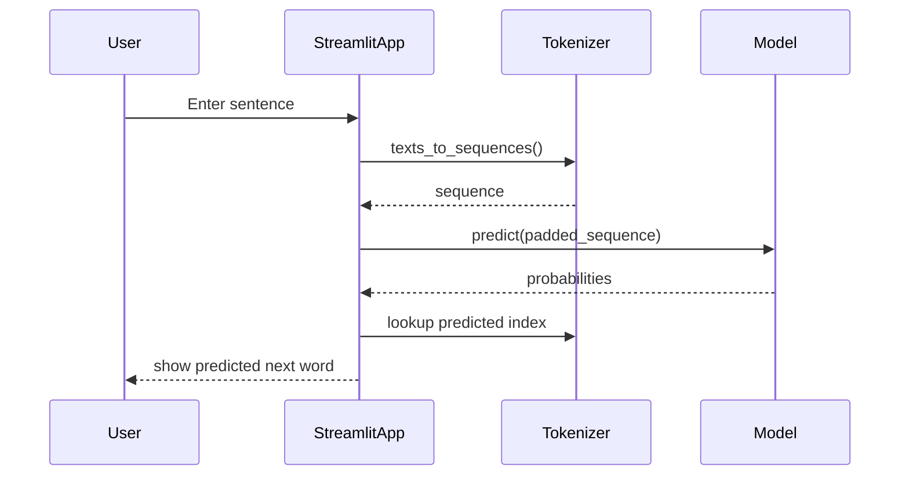

# Next Word Prediction (LSTM)

## Project Overview

This project provides a simple interactive web app that predicts the next word in a user-provided sentence using a trained LSTM (Long Short-Term Memory) neural network. The app is implemented with Streamlit for a minimal browser UI and uses a pre-trained Keras model, tokenizer, and sequence length metadata to produce single-word predictions.

This README is written for both technical and non-technical readers: it explains what the project does, how it works, how to run it locally, and where to look in the codebase for details.

## Problem Statement — Why this is useful

Predicting the next word in a sentence is a core capability for text-completion, writing assistance, and language modeling. This project demonstrates a compact example of how a sequence model (LSTM) can be used to:

- Assist users in typing faster by suggesting the next word.
- Demonstrate an end-to-end ML workflow: dataset → tokenizer → model → inference → UI.
- Serve as a learning example for sequence models and Streamlit deployment.

## Key Features

- Simple Streamlit web UI to enter text and get the predicted next word.
- Pre-trained Keras LSTM model stored as `lstm_model (1).h5`.
- Tokenizer and sequence-length metadata persisted as `tokenizer.pkl` and `max_len.pkl`.
- Quote dataset included (`qoute_dataset.csv`) used during training (provided as an artifact).
- Minimal, dependency-light setup suitable for demonstration and local testing.

## How It Works — High-level Workflow

User journey (start → finish):

1. User opens the Streamlit app in a browser.
2. User types a partial sentence into the input field.
3. The app converts the input text to tokens using the saved `tokenizer`.
4. Tokens are padded to the length expected by the model (`max_len`).
5. The LSTM model predicts the most probable next-token index.
6. The tokenizer mapping is used to convert the index back to a word.
7. The predicted next word is shown to the user in the UI.

Mermaid sequence diagram:



## Architecture & Technical Design

This is a single-process, single-page Streamlit application. There is no external API, database, or background service in the repository — inference runs locally in the Streamlit process.

Components:

- `app.py` — Streamlit application and inference logic (entry point).
- `lstm_model (1).h5` — Keras model file (LSTM) used for inference.
- `tokenizer.pkl` — Pickled Keras tokenizer (word→index mapping and reverse mapping via `word_index`).
- `max_len.pkl` — Pickled integer describing the maximum sequence length used at training time.
- `qoute_dataset.csv` — CSV dataset (quotes + authors) included in the repository (likely used for model training/experimentation).
- `codefile.ipynb`, `RNNimplementation.ipynb` — Jupyter notebooks included as training/experimentation artifacts.

How components interact:

- The Streamlit app (`app.py`) loads the model and tokenizer on start (cached to avoid reloads).
- When the user requests a prediction, the app tokenizes and pads the input, calls `model.predict`, then maps the predicted index back to the word using `tokenizer.word_index`.

## Technology Stack

- Python: Primary language for the app and notebooks.
- Streamlit: Lightweight web UI to host and interact with the model locally.
- TensorFlow / Keras: Model format and prediction APIs (`load_model`, `predict`).
- NumPy: Numerical arrays and utilities used during prediction.
- pickle (Python stdlib): For storing and loading `tokenizer` and `max_len` metadata.
- Jupyter Notebooks: Training and experimentation artifacts (`RNNimplementation.ipynb`, `codefile.ipynb`).

Why these technologies are used:

- Streamlit enables quick, minimal effort to create an interactive UI for ML demos.
- TensorFlow/Keras provides the model training and easy model serialization to `.h5`.
- NumPy is the de facto numeric library for model inputs and predictions.
- `pickle` is a small, straightforward choice to persist Python objects like tokenizers.

## Project Structure

Folder tree (top-level files shown):

- Next_word_prediction/
  - app.py
  - codefile.ipynb
  - RNNimplementation.ipynb
  - lstm_model (1).h5
  - tokenizer.pkl
  - max_len.pkl
  - qoute_dataset.csv

Explanation of important files:

- `app.py`: Main application file. Run this with Streamlit to start the interactive app.
- `qoute_dataset.csv`: Training dataset of quotes (columns: `quote`, `Author`). Useful for retraining or analysis.
- `lstm_model (1).h5`: Trained LSTM model used for inference.
- `tokenizer.pkl`: Tokenizer mapping required to convert text ↔ token indices.
- `max_len.pkl`: Integer that defines expected input length for padding.
- `*.ipynb`: Notebooks containing training code, experiments, or documentation of model development.

## Database Design

There is no live database or persistent database schema in this repository. The project uses static files for data and model artifacts:

- `qoute_dataset.csv` — CSV with two columns: `quote` and `Author`.

Data flow summary:

- Training phase (not included as runnable code here) likely read `qoute_dataset.csv`, preprocessed text, fit a tokenizer, created sequences, trained the LSTM, and saved `lstm_model (1).h5`, `tokenizer.pkl`, and `max_len.pkl`.
- Inference phase (implemented in `app.py`): user input -> tokenizer -> padding (using `max_len`) -> model -> predicted token index -> token→word lookup -> display result.

## Setup & Installation

Follow these steps to run the app locally.

Prerequisites

- Python 3.8+ installed (recommended).
- `pip` for package installation.
- A machine with enough memory to load the Keras model. If using CPU-only TensorFlow, startup may be slower.

Recommended virtual environment (Windows example):

```powershell
python -m venv .venv
.\.venv\Scripts\Activate.ps1   # PowerShell
# or using cmd.exe
.\.venv\Scripts\activate.bat
```

Install required packages

There is no `requirements.txt` in the repository; install these minimum packages explicitly:

```bash
pip install streamlit tensorflow numpy
```

Notes on versions

- Use a TensorFlow version compatible with the saved `.h5` model. If you encounter `ValueError` or `NotImplementedError` when loading `lstm_model (1).h5`, try upgrading/downgrading TensorFlow to match the model's training environment (common: `tensorflow==2.6.0` to `2.13.x` depending on when the model was saved).

Run the app

From the `Next_word_prediction/` directory:

```bash
streamlit run app.py
```

This will open a local browser tab (or provide a local URL) with the UI.

## Usage Guide

1. Start the app with `streamlit run app.py`.
2. In the browser, type a partial sentence into the input field.
3. Click the `Predict Next Word` button.
4. The app will show a predicted single next word.

Example workflows / use cases:

- Writer's assistant: use the prediction to explore possible next words while drafting text.
- Educational demo: show students how sequence models make predictions from tokenized input.

## API Documentation

This repository does not expose a remote HTTP API; inference is provided by a local Streamlit app. The core inference logic is in `app.py` — relevant functions and behavior:

- `load_resources()` — loads the Keras model (`lstm_model (1).h5`), `tokenizer.pkl`, and `max_len.pkl`. This function is cached by Streamlit to avoid repeated loads.

- `predict_next_word(text: str) -> str` — Core prediction function. Steps:
  1. `tokenizer.texts_to_sequences([text])` to obtain sequence indices.
  2. `pad_sequences([sequence], maxlen=max_len-1, padding='pre')` to match model input size.
  3. `model.predict(sequence)` returns probabilities.
  4. `np.argmax(preds)` selects the predicted index.
  5. Reverse lookup using `tokenizer.word_index` to return the matching word.

Code excerpt (from `app.py`):

```python
sequence = tokenizer.texts_to_sequences([text])[0]
sequence = pad_sequences([sequence], maxlen=max_len-1, padding='pre')

preds = model.predict(sequence, verbose=0)
predicted_index = np.argmax(preds)

for word, index in tokenizer.word_index.items():
    if index == predicted_index:
        return word
```

Limitations to note:

- Model returns a single word chosen by argmax; probabilistic ranking or top-k suggestions are not currently supported.
- Unknown tokens (words not seen during training) may not predict well.

## Screenshots & Visuals

Add screenshots to the repository under `Next_word_prediction/screenshots/` (create this folder) showing:

- The app landing page with the text input.
- An example prediction result.
- (Optional) Notebook screenshots showing training logs or loss curves.

Suggested filenames:

- `screenshots/app-home.png` — app landing view.
- `screenshots/prediction-example.png` — sample prediction display.

Insert the following in the README where you want the images to appear (replace paths with actual images):


## Challenges & Solutions

Observed constraints and how the project addresses them (derived from repository files):

- Small demo setup: The app keeps inference local and self-contained (model + tokenizer + metadata files), which simplifies reproducibility.
- Model loading time: `load_resources()` is decorated with `@st.cache_resource` in `app.py` to cache model and tokenizer between runs in Streamlit, avoiding repeated expensive loads.

## Future Improvements

Suggested enhancements that are realistic and aligned with the current repository contents:

- Add a `requirements.txt` with pinned package versions for reproducible setup.
- Provide a `Dockerfile` to make running the app environment-independent.
- Add top-k suggestions and probability scores instead of a single argmax word.
- Improve tokenizer reverse lookup performance by storing an index→word map at training time (so the app does not iterate over the full `word_index`).
- Add unit tests around `predict_next_word` including edge cases (empty input, unknown tokens).
- Provide a small API wrapper (FastAPI / Flask) to serve the model as a service for other applications.
- Provide model training scripts that show how `qoute_dataset.csv` was processed to reproduce the artifacts.

## Security & Privacy

- All inference is local; no external services are called by the app.
- The dataset contains quotes and publicly-known authors; ensure any re-use of the dataset respects its original license (no license file included here).

## Conclusion

This repository is a minimal, self-contained demonstration of next-word prediction using an LSTM model and Streamlit for interactive inference. It is ideal for learning, demoing, and prototyping next-word suggestion features. To get started, install the dependencies and run:

```bash
streamlit run app.py
```

If you'd like, I can:

- Add a `requirements.txt` with tested package versions.
- Create the `screenshots/` folder and add placeholder images and instructions.
- Implement top-k suggestions and a small API wrapper.

---

**Project files referenced**:

- [app.py](app.py)
- [qoute_dataset.csv](qoute_dataset.csv)
- [lstm_model (1).h5](lstm_model%20(1).h5)
- [tokenizer.pkl](tokenizer.pkl)
- [max_len.pkl](max_len.pkl)
- [codefile.ipynb](codefile.ipynb)
- [RNNimplementation.ipynb](RNNimplementation.ipynb)

